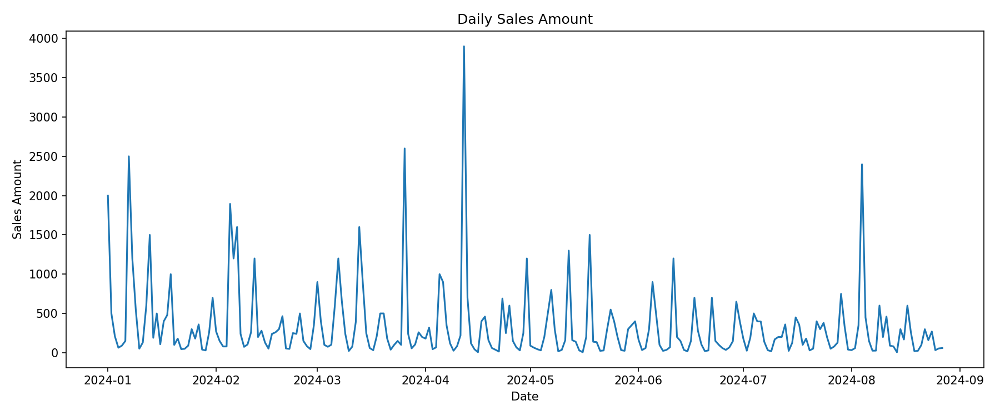
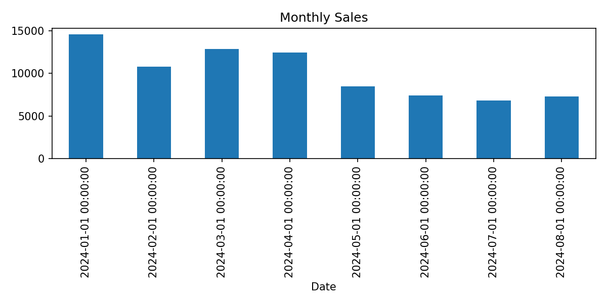
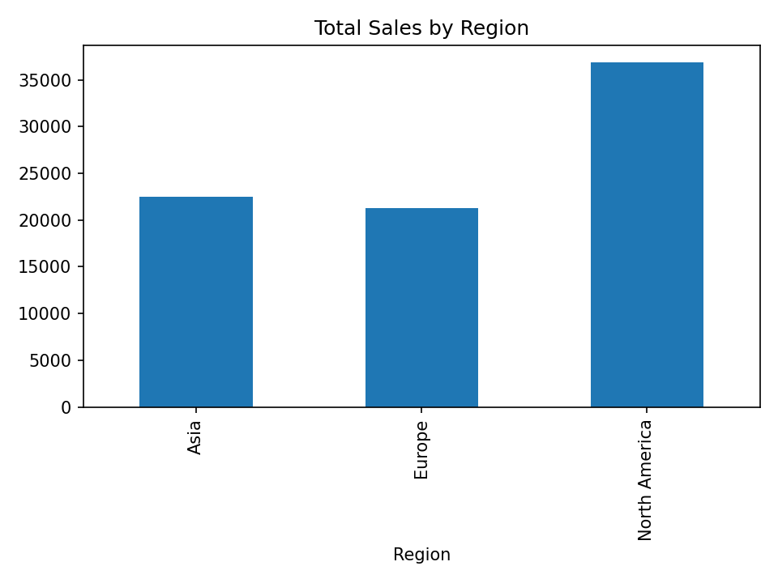
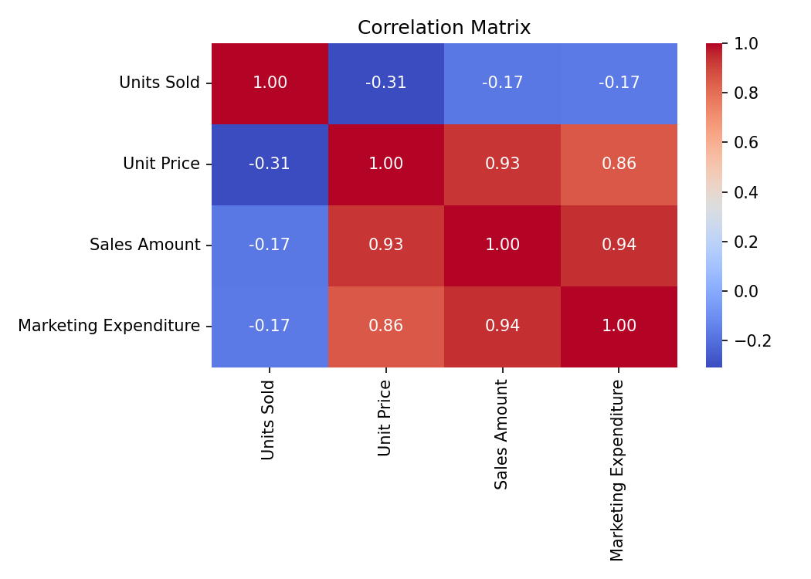
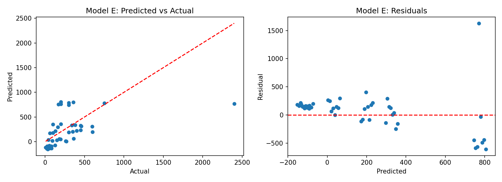

# Retail Sales Analysis: Linear Algebra and Regression

Analysis of 240 retail transactions using linear algebra and regression to identify sales patterns and test how well sales can be predicted*

## Objectives
1. Identify trends and patterns in sales through exploratory analysis.
2. Express regression in linear algebra terms (design matrix, normal equation, SVD, condition number, VIF).
3. Predict sales with regression, evaluate the models honestly (chronological split, explicit leakage checks), and translate the findings into business recommendations.

## Dataset
- 240 transactions, daily from 1 Jan 2024 to 27 Aug 2024, no missing values.
- The CSV has no header row, so column names are assigned in code: Transaction ID, Date, Product Category, Product Name, Units Sold, Unit Price, Sales Amount, Region, Payment Method, Marketing Expenditure.

## Project structure
```
sales_analysis.py     main script
data/Sales_data.csv   dataset
figures/              generated plots
requirements.txt
```

## How to run
```bash
pip install -r requirements.txt
python sales_analysis.py
```

## Findings
## Output

 Key results:

**Correlation matrix**
```
                       Units Sold  Unit Price  Sales Amount  Marketing Expenditure
Units Sold                   1.00       -0.31         -0.17                  -0.17
Unit Price                  -0.31        1.00          0.93                   0.86
Sales Amount                -0.17        0.93          1.00                   0.94
Marketing Expenditure       -0.17        0.86          0.94                   1.00
```

**Data checks**
```
Largest gap between Sales and Price x Units: 1.1368683772161603e-13
Marketing / Sales ratio: min 0.051, mean 0.098, max 0.149
```

**Linear algebra**
```
Normal-equation coefficients: [17.9865806  10.30303326 -5.77950272]
sklearn:                      [17.98658059567191 10.30303326 -5.77950272]
Singular values: [16.72476039 14.15211609]
Condition number: 1.1817851328379612
Eigenvalues: [0.83450996 1.16549004]
VIF: [1.02815812 1.02815812]
```

**Model results (chronological split)**
```
A  marketing only:            R2=0.9398  RMSE=88.31
B  marketing + units:         R2=0.9374  RMSE=90.05
C  price + units:             R2=0.9526  RMSE=78.36
D  log-log:                   R2=1.0000  RMSE=0.00
E  time + region + category:  R2=0.1109  RMSE=339.31
Naive mean baseline R2: -0.0877
```
**Figures**







### 1. Exploratory analysis
| Observation | Evidence |
|---|---|
| Monthly sales fell from about 14.5k (Jan) to about 6.8k (Jul), with a slight rise in Aug (7.3k, partial month: 27 days) | `figures/monthly_sales.png` |
| North America generated the most sales (36,844), ahead of Asia (22,455) and Europe (21,268) | `figures/sales_by_region.png` |
| Electronics (34,982) and Home Appliances (18,646) dominate; Books (1,862) is smallest | printed output |
| Sales correlate strongly with marketing (r = 0.94) and weakly and negatively with units sold (r = -0.17) | `figures/correlation.png` |

### 2. Data checks that change how results must be read
- **Sales Amount = Unit Price x Units Sold exactly** (largest difference 1.1e-13).
- **Marketing Expenditure is 5.1% to 14.9% of each row's sales** (mean 9.8%).

The strong sales-marketing correlation therefore most likely reflects how the data was generated, not marketing causing sales. The dataset appears to be synthetic, so results describe the data, not real retail behaviour, and marketing effects cannot be interpreted causally.

### 3. Linear algebra
Regression is written as **y = Aβ + ε**, where **A** is the n x (p+1) design matrix (a column of ones plus the features). Least squares has the closed form **β̂ = (AᵀA)⁻¹Aᵀy**.

For sales on marketing and units sold:

| Quantity | Result |
|---|---|
| Coefficients (intercept, marketing, units) | 17.99, 10.30, -5.78 (identical from `numpy.linalg.lstsq` and scikit-learn) |
| Singular values of standardised features | 16.72, 14.15 |
| Condition number (σmax / σmin) | 1.18 |
| Eigenvalues of correlation matrix | 0.83, 1.17 |
| VIF | 1.03, 1.03 |

A condition number near 1 and VIFs near 1 show **no multicollinearity**: AᵀA is well-conditioned, so coefficients are stable.

### 4. Models (chronological split: first 192 days train, last 48 days test)
| Model | Features | Test R² | RMSE |
|---|---|---|---|
| A | Marketing | 0.940 | 88.3 |
| B | Marketing + Units Sold | 0.937 | 90.1 |
| C | Unit Price + Units Sold | 0.953 | 78.4 |
| D | log(Unit Price) + log(Units Sold) -> log(Sales) | 1.000 | 0.0 |
| E | Day index + Region + Product Category | 0.111 | 339.3 |
| Baseline | Training-set mean | -0.088 | n/a |

**Interpretation**
- **A and B** score highly only because marketing is 5-15% of sales: leakage by construction, not predictive power.
- **C and D** recover the identity Sales = Price x Units. In D, logs make it linear (log S = log P + log U), so both coefficients are exactly 1 and R² = 1. This is an identity, not a discovery.
- **E** is the only real forecast. It explains about 11% of variance (RMSE 339 against a sales standard deviation of 486), better than the naive baseline but weak, and uncertain with 240 rows and one split.

**Insights**
1. **Sales are falling.** Monthly sales dropped from about 14.5k in January to about 6.8k in July (roughly -53%), with a small recovery in August (7.3k from 27 days of data). With only 8 months of data we cannot tell whether this is seasonality or a real decline.
2. **North America leads because of transaction value, not volume.** All three regions have exactly 80 transactions, but North America averages about 461 per transaction against about 281 (Asia) and about 266 (Europe). It accounts for about 46% of sales.
3. **Sales are concentrated in a few categories.** Electronics (about 43%) and Home Appliances (about 23%) together make up two thirds of revenue. Beauty Products and Books together contribute under 6%.
4. **Sales value is driven by price, not quantity.** Sales correlate negatively with units sold (r = -0.17), and units sold fall as price rises (r = -0.31). High-value items such as electronics are bought in small quantities, so revenue comes from what is sold, not how many.
5. **The marketing-sales link cannot be taken at face value.** Marketing is always 5-15% of sales, so the r = 0.94 reflects how spend is allocated, not proof that spend produces sales (Section 2). Marketing-based models (R² about 0.94) should not be used to justify budgets.
6. **Sales cannot yet be forecast reliably.** The only genuine forecasting model (E) explains about 11% of variance with large errors (RMSE 339 against a sales standard deviation of 486), so planning should not rely on it.

### Recommendations

|---|---|---|
| 1 | Investigate the Jan-Jul decline (pricing, stock, promotions, competitors) before setting targets; collect at least 12-24 months of data to separate seasonality from trend | Insight 1 |
| 2 | Protect and grow the high-value categories: keep Electronics and Home Appliances well stocked and consider bundles or accessories to lift basket value | Insights 3-4 |
| 3 | Study why North America's transactions are worth more (product mix, pricing, customer type) and test whether Asia and Europe can replicate it | Insight 2 |
| 4 | Review low-contribution categories (Books, Beauty) for repositioning, cross-selling or range reduction | Insight 3 |
| 5 | Run a controlled marketing test (for example, vary spend by region or period independently of sales) to measure real marketing effectiveness before changing budgets | Insight 5 |
| 6 | Add predictors available in advance (promotions, holidays, customer segments, stock levels, competitor prices) and re-test forecasts using a chronological split | Insight 6 |

## Limitations
- Synthetic-looking data: sales and marketing are mechanically related, so causal conclusions are not possible.
- Models A to D use inputs that determine the target and are not genuine forecasts.
- Model E is linear in time and cannot capture seasonality or non-linear trends; a single chronological split gives one noisy estimate.
- Only 240 observations and about 8 months of data, so seasonality cannot be assessed.
